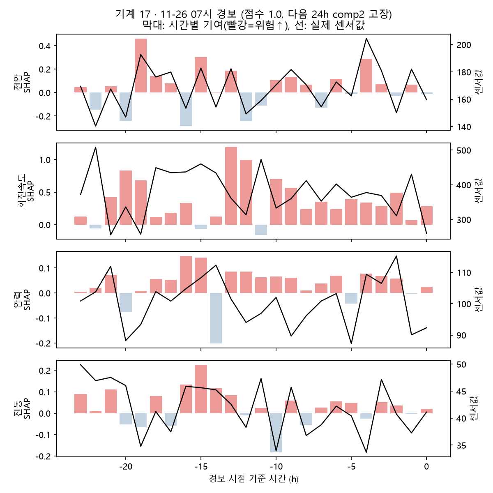
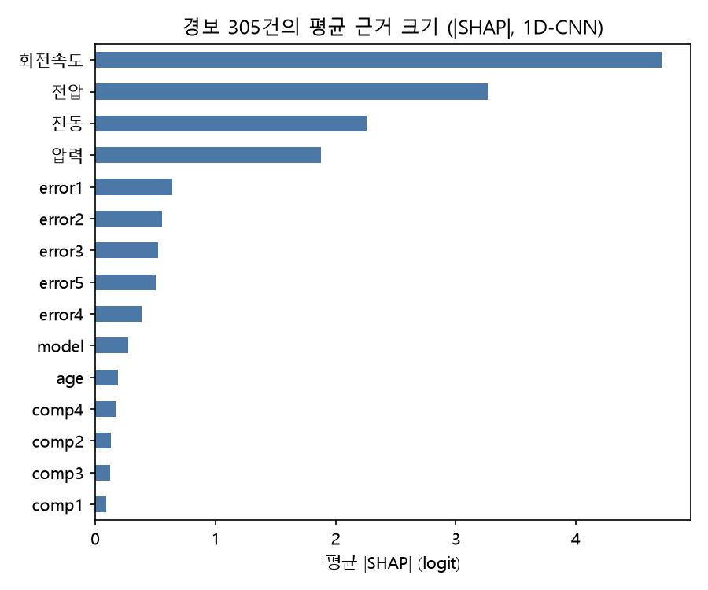
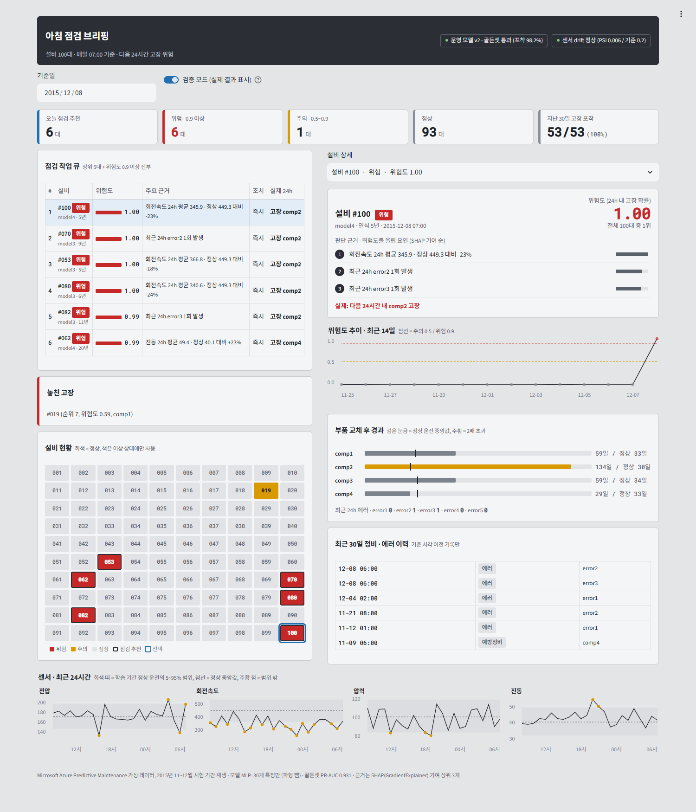

# 정비 기록으로 라벨을 바로잡는 설비 고장 예측

**대시보드 데모**: https://pdm-maintenance-labels-ydzlbzzz2drpjjuvxjnen4.streamlit.app/

공장 기계 100대의 센서·에러·정비·고장 기록으로 **"24시간 안에 고장 날 기계"를 매일 아침 알려주는 모델**을 만들었습니다.
정확도 자체보다 **현장에서 믿고 쓸 수 있는가**에 집중했습니다. 정답(라벨)을 정비 기록으로 먼저 검증했고, 경보마다 근거를 붙였으며, 나쁜 모델은 배포 전에 자동으로 막도록 했습니다.

| 단계 | 한 일 | 핵심 결과 |
|---|---|---|
| 1. 데이터 확인 | 5개 파일 구조·품질 점검 | 고장 18건이 정비 기록 없이 데이터 시작 직후 한 시각에 몰려 있음 → 기록 오류 의심 |
| 2. 라벨 바로잡기 | 예방정비 / 실고장 구분, onset 보정(고장 전 24h) | 정비 3,286건 = 고장 교체 743 + 예방정비 2,543 |
| 3. 모델 비교 | IsolationForest vs PyTorch 1D-CNN, 같은 경보 수 | 하루 3대 점검 시 고장 69% → **87%** 포착 |
| 3+. 파형 효과 검증 | CNN에서 파형을 뺀 버전과 seed 3회 비교 | 파형 이득 없음 → 운영에는 더 단순한 모델 선택 |
| 4. 판단 근거 | SHAP(특징 + 시간별 파형 기여) | 경보마다 "이유 3줄" + 센서 그래프 |
| 5. 운영 준비 | MLflow 등록, 골든셋 게이트, PSI drift | 라벨 보정을 뺀 모델(포착률 20%)을 게이트가 자동 차단 |
| 6. 대시보드 | 정비팀장용 아침 점검 브리핑 (Streamlit) | 상위 5대 + 위험도 0.9 이상 정책으로 고장 110/111 포착 |

## 데이터

- Microsoft Azure Predictive Maintenance 샘플 데이터 ([Kaggle](https://www.kaggle.com/datasets/arnabbiswas1/microsoft-azure-predictive-maintenance)). 원래 Azure 저장소 주소는 현재 접속되지 않습니다.
- **연구용 가상 데이터**라 실제 공장보다 점수가 높게 나옵니다.
- 라이선스가 명시되어 있지 않습니다(Kaggle 표기 Unknown). 원본 CSV 전체는 이 저장소에 포함하지 않으니, 위 링크에서 받아 `데이터/raw/`에 넣으세요.
- 예외: 대시보드 배포를 위해 `app/data/`에 시험 기간(2015년 11~12월)의 센서값과 정비·에러·고장 기록 일부, 모델 결과를 넣었습니다. 출처는 위 Microsoft 샘플 데이터이며, 권리자 요청이 있으면 삭제합니다.

| 파일 | 크기 | 내용 |
|---|---|---|
| telemetry | 876,100행 | 기계 100대 × 2015년 매시간, 전압·회전속도·압력·진동 |
| errors | 3,919행 | error1~5 |
| maint | 3,286행 | 부품(comp1~4) 교체, 2014-06부터 |
| failures | 761행 | 고장 부품 |
| machines | 100행 | 모델(4종)·연식 |

## 2. 라벨 바로잡기 — `src/step2_labels.py`

정답이 틀리면 모델은 틀린 것을 정확하게 배웁니다. 그래서 학습 전에 정비 기록으로 라벨부터 검증했습니다.

- **예방정비 / 실고장 구분**: 같은 시각·기계·부품의 고장 기록이 있는 교체만 실고장 교체(743건)로 보고, 나머지 2,543건은 예방정비로 분류했습니다.
- **기록 누락**: 고장 761건 중 18건은 정비 기록이 없습니다. 18건 모두 2015-01-02 03시, 즉 데이터 시작 21시간 뒤에 몰려 있습니다(나머지 고장은 모두 06시). 고장으로 두되 `fail_no_maint` 표시를 붙였습니다.
- **onset 보정**: 고장 시각 F 기준 (F−24h, F]를 "고장 진행 중"(y=1)으로 표시했습니다. 고장 시각 1시간만 정답으로 두면 하루 전에 알릴 수 없습니다.
- **동시 고장**: 같은 시각 여러 부품 고장(42건)은 한 이벤트로 합치고 부품 목록은 따로 보관했습니다 → 고장 이벤트 719건.
- 결과: y=1은 전체의 **1.96%**. 드문 사건이라 정확도 대신 PR-AUC와 "같은 경보 수에서 잡은 고장 수"로 평가했습니다.

## 3. 모델 비교 — `src/step3_features.py`, `src/step3_models.py`

- **특징 30개**: 센서 4종의 최근 3h·24h 평균/표준편차, 최근 24h 에러 횟수, 부품별 마지막 교체 후 경과 시간, 모델·연식
- **기간**: 1~8월 학습 / 9~10월 조율 / 11~12월 시험. 경계 직전 24h는 버려서 미래 정보가 섞이지 않게 했습니다.
- **누수 방지**: 고장 시각의 교체 기록이 입력에 들어가지 않도록 같은 시각 교체는 경과 시간 계산에서 뺐습니다. 정규화도 학습 기간 값만 씁니다.
- **비교 방식**: 매일 07시 100대 중 위험 점수 상위 N대를 점검한다고 가정합니다. 두 모델 모두 하루 N대라 경보 수가 같습니다.

| 시험 기간 (고장 111건) | IsolationForest (정상만 학습) | 1D-CNN (라벨로 학습) |
|---|---|---|
| PR-AUC (시간별) | 0.628 | **0.919** |
| 하루 3대: 잡은 고장 / 적중률 | 77 (69%) / 42% | **97 (87%) / 53%** |
| 하루 5대 | 93 (84%) / 30% | **108 (97%)** / 35% |
| 하루 10대 | 108 (97%) / 18% | 110 (99%) / 18% |

하루 평균 고장이 1.8건이라 하루 3대 점검 시 적중률 상한은 약 61%입니다.

### 3+. 파형이 정말 필요한가 — `src/step3_ablation.py`

CNN에서 24시간 파형 입력만 빼고 같은 조건으로 seed 3회 반복했습니다.

| | PR-AUC (평균, 범위) | 하루 3대 | 하루 5대 |
|---|---|---|---|
| 파형 + 특징 (1D-CNN) | 0.923 (0.919~0.927) | 97/111 | 108/111 |
| 특징만 (MLP) | **0.933** (0.931~0.935) | 97/111 | **109/111** |

센서가 시간당 1번 기록이라 24h 평균·표준편차가 이미 신호를 담고 있어서, 파형은 이득이 없었습니다. CNN은 kHz급 진동 파형처럼 모양 자체에 정보가 있는 데이터에서 다시 검토할 대상으로 남겼습니다.

## 4. 판단 근거 — `src/step4_explain.py`

SHAP GradientExplainer로 특징별 기여와 24시간 파형의 시간별 기여를 함께 계산했습니다. 현장에서 읽기 쉽게 센서(파형+이동 통계)·에러 종류·부품별 교체 경과·연식·모델 단위로 묶었습니다. SHAP 합과 모델 점수의 상관은 0.976입니다.

**경보 예시** (17번 기계, 11-26 07시 → 다음 날 comp2 고장)
1. 회전속도 24시간 평균 377.7 (정상 중앙값 449.3), 13시간 전 파형 영향 최대
2. 최근 24시간 error2 2회
3. 최근 24시간 error3 1회





**놓친 고장 3건 (하루 5대 기준)**: 12-08에 고장이 7대 몰렸고, 모델은 7대를 정확히 1~7위로 뽑았지만 하루 5대 제한으로 2대가 밀렸습니다. 진짜 놓친 건 1건(64번, 점수 0.003)이고, 고장 직전 1시간에만 전압이 올라 미리 알 신호가 거의 없었습니다.
→ 운영 제안: 하루 대수 고정과 함께 "점수 0.9 이상은 모두 점검" 같은 기준을 두면 고장이 몰린 날에도 대응할 수 있습니다.

전체 경보 305건의 이유: [`결과/step4_alert_reasons.csv`](결과/step4_alert_reasons.csv)

## 5. 운영 준비 — `src/step5_mlops.py`

**골든셋 게이트**: 11~12월을 고정 시험지로 둡니다. 다음 중 하나라도 미달이면 배포를 차단합니다.
- 하루 5대 기준 고장 포착 95% 이상
- PR-AUC 0.90 이상
- 현재 운영 모델 대비 1%p 넘게 나빠지지 않을 것

| MLflow 버전 | 후보 | PR-AUC | 하루 5대 포착 | 결과 |
|---|---|---|---|---|
| v1 | 1D-CNN | 0.919 | 97.3% | 통과 → 승격 |
| v2 | MLP (파형 뺌) | 0.931 | 98.2% | 통과 → **현재 운영 모델** |
| v3 | MLP, 라벨 보정 없음 (고장 시각 1시간만 정답) | 0.082 | 19.8% | **차단** |

모든 후보를 MLflow 모델 레지스트리에 등록하고, 게이트 결과는 버전 태그(`gate=passed/blocked`)로, 운영 모델은 alias `champion`으로 관리합니다.

**Drift 감지**: 특징별 PSI(학습 분포 vs 최근 7일)가 0.2를 넘으면 재학습 알림을 보냅니다.

| 상황 | PSI 최대 | 알림 |
|---|---|---|
| 평소 최근 7일 | 0.006 | 없음 |
| 전압 센서 +10% 오차 주입 | 8.283 (volt_mean24h) | 전압 특징 3개 |

처음에는 부품 교체 경과 시간도 감시했는데, 평소 주간에도 PSI 0.27로 오경보가 났습니다. 이 값은 정비 일정에 따라 원래 바뀌는 값이므로 감시 대상에서 빼고, **측정값(센서·에러)만 감시**하도록 정책을 정했습니다.

## 6. 아침 점검 브리핑 대시보드 — `app/app.py`

정비팀장이 매일 아침 07시에 보는 한 페이지입니다. 실제 설비 관리 화면을 참고해 설계했습니다.

- **ISA-101 고성능 HMI**: 회색 바탕을 쓰고 색은 이상 상태에만 씁니다(빨강 = 위험, 주황 = 주의, 파랑 = 선택). 평소 화면이 조용해야 이상이 바로 눈에 띕니다.
- **IBM Maximo Health/Predict**: 고장 확률 높은 설비를 모은 작업 큐, 설비 상세의 점수와 기여 요인을 참고했습니다.
- **Siemens Senseye · AWS Monitron**: 위험 순 정렬 목록과 정상/주의/위험 3단계 상태를 참고했습니다.

| 영역 | 내용 |
|---|---|
| 상단 | 운영 모델 버전과 게이트 통과 여부, 센서 drift 상태 |
| 요약 | 점검 추천 · 위험 · 주의 · 정상 대수 |
| 점검 작업 큐 | 상위 5대 + 위험도 0.9 이상 전부 (4단계 놓친 고장 분석에서 나온 정책). 이 정책으로 고장 110/111 포착 (하루 5대 고정 시 109) |
| 설비 현황 맵 | 100대를 한눈에 보는 격자, 이상 설비만 색 표시 |
| 설비 상세 | 위험도, 순위, SHAP 근거 3줄, 14일 위험도 추이, 부품 교체 경과(정상 중앙값 대비), 최근 30일 정비·에러 이력 |
| 센서 24시간 | 학습 기간 정상 운전의 5~95% 범위를 띠로 표시, 범위 밖 시점 강조 |
| 검증 모드 | 과거 데이터 재생이라 다음 24시간 실제 고장 여부, 놓친 고장, 지난 30일 포착률 표시 |



화면은 운영 모델(MLflow `champion`, 파형 뺀 MLP)의 결과를 `src/step6_dashboard_data.py`로 미리 계산한 `app/data/`만 읽습니다. 그래서 배포 환경에 PyTorch나 MLflow가 필요 없습니다.

## 실행 방법

```bash
pip install -r requirements.txt
# 데이터/raw/에 PdM_*.csv 5개를 넣은 뒤
python src/step2_labels.py
python src/step3_features.py
python src/step3_models.py      # IsolationForest, 1D-CNN 학습 (CPU 약 3분)
python src/step3_ablation.py    # 파형 유무 비교, seed 3회 (CPU 약 13분)
python src/step4_explain.py
python src/step5_mlops.py       # MLflow 기록은 실행마다 새로 시작
python src/step6_dashboard_data.py
streamlit run app/app.py
mlflow ui --backend-store-uri sqlite:///mlflow.db
```

## 한계

- 가상 데이터라 실제 현장보다 성능이 높게 나옵니다. 실데이터에서는 결측·센서 교체·라벨 지연을 먼저 다뤄야 합니다.
- 골든셋이 성능 보고에 쓴 시험 기간과 같고, 운영 모델 선택도 여기서 했습니다. 실제 운영에서는 별도 보관 기간을 두어야 합니다.
- drift 알림 → 재학습 → 게이트 중 재학습을 자동으로 이어 붙이지는 않았고, 게이트 단계만 시연했습니다.
- 시험 기간 고장이 111건이라 1~2건 차이는 우연일 수 있습니다.

## 폴더

```
src/       단계별 스크립트 (step2 ~ step6)
app/       Streamlit 대시보드 (app/requirements.txt는 배포용)
결과/       그림, 경보 근거, 게이트·drift 결과
데이터/     (제외) raw CSV, 중간 산출물
models/    (제외) 학습된 모델
```
